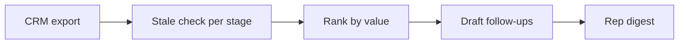

# CRM Follow-up Automation

> Finds the deals going quiet and drafts the follow-up before they die.

     

**Sector:** Sales & CRM  ·  **Project 10 of 50** in my [AI Automation Projects series](https://github.com/Princewill106/Princewill106)

## The problem

Most deals are not lost to competitors. They are lost to silence: a proposal sent, then nothing for three weeks. Reps know they should follow up; they just don't know which deal to chase first today.

## How it works



1. **Load** — Read deals (owner, stage, value, last contact, notes) from `sample_deals.csv`.
2. **Stale check** — Each stage has its own silence limit in `STALE_DAYS` (e.g. proposal sent: 5 days).
3. **Rank** — Stale deals are ranked by value × days silent so the costliest silence comes first.
4. **Draft** — A follow-up is drafted per stage using the last note for context.
5. **Digest** — Each rep gets their own list in `output/digest_<rep>.md`.

## Features

- Stage-specific staleness rules
- Value-weighted priority
- Context-aware drafts using last note
- Per-rep markdown digests
- Ignores won/lost deals

## Quick start

```bash
git clone https://github.com/Princewill106/crm-followup-automation.git
cd crm-followup-automation
python main.py --demo
```

No installs needed: it uses only the Python standard library. The demo runs fully offline using the sample data in this repo.

**Optional: plug in an LLM.** Copy `.env.example` to `.env` and add an Anthropic or OpenAI key. The project will then use the model for the language-heavy steps and fall back to its rule-based logic if a call fails.

Run the tests:

```bash
python -m unittest -v
```

## Sample output

```text
== Tunde: 3 deals to chase ==
  Zenith Clinics       negotiation     NGN   4,200,000  silent 7d
     draft: Hi Dr Musa, I wanted to close the loop on patient reminder system. Is there anything blocking a decision this week?
  Harbour Traders      discovery call  NGN     900,000  silent 9d
     draft: Hi Mr Obi, great speaking with you. As promised, here are next steps on inventory alerts. Shall I send a proposal?
  Delta Events         new lead        NGN     250,000  silent 8d
     draft: Hi Ese, following up on your enquiry about event registration automation. When's a good time for a quick call?

== Kemi: 1 deals to chase ==
  Bright Schools       proposal sent   NGN   2,500,000  silent 11d
     draft: Hi Mrs Ade, checking you received the proposal for AI staff training. Happy to walk through it or adjust scope.

4 stale of 6 deals. Digests saved in output/
```

## Use it in n8n (no code needed)

[`n8n-workflow.json`](n8n-workflow.json) is a ready-to-import n8n version of this project, built for n8n 1.x.

1. In n8n, open **Workflows → Import from File** and choose `n8n-workflow.json`.
2. Click **Test workflow**. It runs the full logic on the sample data built into the *Sample data* node, so you can see the results before connecting anything.
3. Open each output node and connect your accounts: Gmail (OAuth2), Google Sheets (OAuth2). For Google Sheets, pick your spreadsheet and sheet.
4. Adjust the settings at the top of the **Logic** node (thresholds, templates, contacts), then **Activate**.

**Flow:** **Schedule (weekdays 7:30am)** → Read deals (CRM export sheet) → **Logic** (Code node)

**Outputs:**
- Email each rep their follow-ups

The Logic node is a JavaScript port of the rules in `main.py`, so you can run the project in n8n without Python.

## Use it on your own data

Export deals from HubSpot, Zoho, Pipedrive or a spreadsheet as CSV with `deal,company,owner,stage,value,last_contact,last_note`, adjust `STALE_DAYS`, and run daily (cron or n8n schedule).

## Project structure

```text
n8n-workflow.json            Importable n8n workflow
.env.example                 Optional API key settings
.gitignore                   Git ignore rules
LICENSE                      MIT license
README.md                    This file
llm.py                       Optional LLM helper (offline fallback)
main.py                      Entry point and core logic
requirements.txt             Dependencies (stdlib only)
sample_deals.csv             Sample input data for the demo
test_main.py                 Unit tests
```

## Who this is for

- B2B sales teams
- Agencies managing proposals
- Founders doing their own sales

## Ideas to extend it

- [ ] Pull deals directly from the HubSpot API
- [ ] Send digests to Slack each morning
- [ ] Log drafted follow-ups back to the CRM
- [ ] Track reply rates per template

## About

Built by **Ogbu Ugochukwu Princewill**, AI Automation Lead and robotics engineer. I teach people and businesses to build with AI, not just talk about it. [LinkedIn](https://www.linkedin.com/in/ugochukwu-ogbu-653a0816a)

If this helped you, give it a ⭐ and share what you built with it.

## License

MIT — see [LICENSE](LICENSE).
